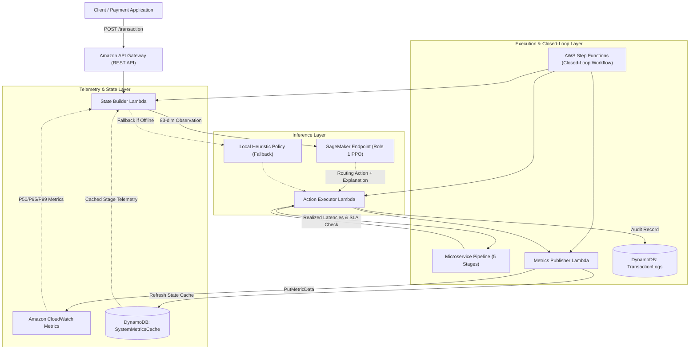

# Role 2: Cloud Infrastructure & Closed-Loop Controller

**Owner:** Anushka Sakhare (Role 2 — Cloud & Systems Engineer)  
**Project:** Autonomous API Performance Optimization Framework for Digital Payment Gateways  
**Integrates With:** Role 3 (Aparajita — Data & Baselines) and Role 1 (Riona — RL Model & SageMaker)

---

## 1. Executive Summary

Role 2 bridges the gap between machine learning models and cloud-native production systems. While Role 3 processes data and establishes baseline benchmarks, and Role 1 trains the reinforcement learning agent, **Role 2 builds the live execution environment and closed-loop feedback controller**.

The closed-loop controller:
1. Ingests payment transactions through **Amazon API Gateway**.
2. Aggregates live system telemetry into an **83-dimensional observation vector** via the **State Builder Lambda**.
3. Obtains autonomous routing decisions from the **Amazon SageMaker PPO model endpoint** (with high-availability local fallback).
4. Dispatches the transaction across **5 microservice stages** (`ingress`, `auth`, `routing`, `processor`, `db`), sampling real-world response times across candidate replicas.
5. Records auditable transaction trails in **Amazon DynamoDB** for financial-compliance reporting.
6. Emits operational metrics to **Amazon CloudWatch** and updates the **SystemMetricsCache** in DynamoDB, completing the feedback loop so the RL agent observes the consequences of its prior routing decisions.

---

## 2. System Architecture



---

## 3. Component Details

### 3.1 State Builder (`src/aws/lambda_state_builder.py`)
- **Input:** Incoming transaction event (`transaction_id`, `type`, `amount`, `fraud_risk`, `slot`, `window_id`).
- **Telemetry Query:** Reads latest latency quantiles (`p50`, `p95`, `p99`), call volume (`n_calls`), and SLA violation flags from `SystemMetricsCache` (or fallback empirical quantiles).
- **Observation Construction:** Builds an exact 83-dimensional `float32` array bounded in `[0, 1]`:
  - `Features 0..74`: 5 stages × 3 candidate replicas × 5 metrics (`p50 / timeout_ms`, `p95 / timeout_ms`, `p99 / timeout_ms`, `log1p(n_calls) / 10.0`, `sla_violation_flag`).
  - `Features 75..79`: 5 one-hot flags for transaction type (`CASH_IN`, `CASH_OUT`, `DEBIT`, `PAYMENT`, `TRANSFER`).
  - `Features 80..82`: `log1p(amount) / log1p(amount_scale)`, `fraud_risk`, `is_transfer_flag`.
- **Inference Invocation:** Invokes the SageMaker endpoint with payload:
  ```json
  {
    "instances": [{
      "observation": [83 floats...],
      "context": {"sla_ms": 374.19, "timeout_ms": 748.38, "fraud_risk": 0.02}
    }]
  }
  ```

### 3.2 Microservices Pipeline (`src/aws/lambda_microservices.py`)
Simulates the realistic 5-stage call chain:
1. `ingress`: API gateway ingress and protocol negotiation.
2. `auth`: Token validation and fraud risk evaluation.
3. `routing`: Dynamic route dispatching.
4. `processor`: Core payment authorization and bank messaging.
5. `db`: Transaction persistence and settlement ledger update.

Each stage dynamically routes to candidate `0`, `1`, or `2` based on the RL agent's decision. Real response times are sampled from the empirical quantile tables generated by Role 3.

### 3.3 Action Executor (`src/aws/lambda_action_executor.py`)
- Coordinates stage execution and calculates total end-to-end latency:
  $$\text{Latency}_{\text{E2E}} = \sum_{s \in \text{stages}} \text{Latency}_s$$
- Checks SLA violation ($\text{Latency}_{\text{E2E}} > \text{SLA}_{\text{ms}}$) and timeout ($\text{Latency}_{\text{E2E}} > \text{Timeout}_{\text{ms}}$).
- Evaluates the multi-objective reward matching Role 1's contract:
  $$\text{Reward} = \text{SuccessBonus} - \frac{\text{Latency}_{\text{E2E}}}{\text{SLA}_{\text{ms}}} - 0.75 \cdot \mathbb{I}_{\text{SLA}} + 0.20 \cdot (1 - \text{FraudRisk})$$
- Generates an auditable explanation identifying the dominant reward term.
- Writes an immutable record to DynamoDB `TransactionLogs`.

### 3.4 Metrics Publisher (`src/aws/lambda_metrics_publisher.py`)
- Emits custom metrics to AWS CloudWatch namespace `AutonomousPaymentAPI`:
  - `EndToEndLatency` (Milliseconds)
  - `SLAViolation` (Binary count)
  - `TransactionSuccess` (Binary count)
  - `RLReward` (Scalar)
  - `FraudRiskScore` (Scalar)
  - Per-stage latencies (`IngressLatency`, `AuthLatency`, etc.)
- Updates `SystemMetricsCache` table in DynamoDB to close the loop.

---

## 4. Infrastructure as Code (`template.yaml`)

All AWS resources are codified using AWS SAM / CloudFormation:
- **API Gateway:** REST API with `/transaction` POST endpoint and CORS configuration.
- **Lambdas:** Python 3.11 runtimes with least-privilege IAM policies.
- **Step Functions:** Amazon States Language workflow (`src/aws/step_function.json`) with automated exponential backoff and failure isolation.
- **DynamoDB:** `TransactionLogs` and `SystemMetricsCache` configured with `PAY_PER_REQUEST` billing to remain within AWS Free Tier.
- **CloudWatch Dashboard:** Real-time visual tracking of P95 latency vs SLA thresholds, violation rates, success rates, and stage breakdowns.

---

## 5. Verification & Testing

Run the Role 2 test suite locally:
```powershell
python -m unittest discover -s tests -p "test_aws_integration.py" -v
```

Run the closed-loop simulation benchmark:
```powershell
python -m src.aws.closed_loop_controller --count 50
```

Results are saved to `results/closed_loop_evaluation.json`.
